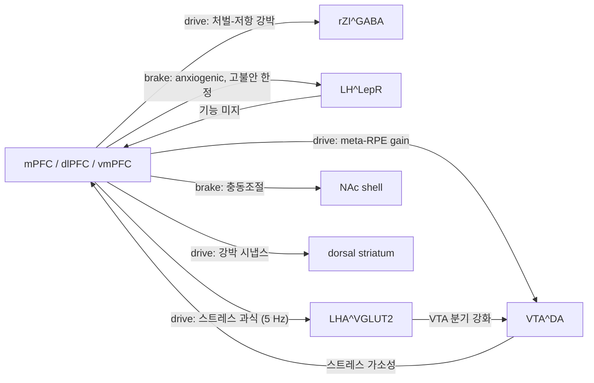

> [!takeaway] 연구 방향 관점의 핵심
> 이 위키에서 PFC는 가장 자주 언급되면서 **hub가 없던 노드**였다([[leow-2026-a-cortical-hypothalamic-neural|Leow 2026]] 본문도 "mPFC — 위키에 전용 hub 없음"이라 적어 두었다). 그 공백이 실제로 해석을 왜곡한다 — **"비만 = dlPFC 저활성 → anodal tDCS로 executive 통제 복원"** 이라는 단일 서술이 [[concept-transcranial-electrical-stimulation|tES]] 자료 전반([[saeki-2022-a-systematic-review-on|Saeki 2022]]·[[beaumont-2022-modulating-eating-behavior-with|Beaumont 2022]]) 의 기전 절을 지배하는데, 같은 위키의 회로 자료는 PFC가 섭식을 **구동**하기도 한다고 말한다.
> 그래서 이 hub의 명제는 하나다: **PFC는 섭식에서 brake와 drive 양방향으로 작동하고, 부호를 결정하는 것은 "PFC 전체의 활성 수준"이 아니라 출력 경로다.** mPFC→rZI는 처벌-저항 강박을 **켜고**([[leow-2026-a-cortical-hypothalamic-neural|Leow 2026]]), mPFC→VTA는 유관성 학습을 **가속**하고([[hjort-2026-prefrontal-to-ventral-tegmental-area|Hjort 2026]]), PFC→LH^LepR은 불안 맥락의 섭식 개시를 **막는**데([[figge-schlensok-2025-a-lateral-hypothalamic-neuronal|Figge-Schlensok 2025]]) 같은 LHA 안의 **mPFC→LHA^VGLUT2는 거꾸로 스트레스 과식을 구동**하고([[supiot-2026-a-prefrontal-cortex-lateral-hypothalamus|Supiot 2026]]), vmPFC→NAc shell은 충동을 **누른다**([[barbosa-2022-aberrant-impulse-control-circuitry|Barbosa 2022]]).
> 사용자 연구에 닿는 세 지점. (1) **자극 방향이 환자군에 따라 뒤집힐 수 있다** — anodal dlPFC 일변도 프로토콜은 brake 결손군을 전제하지만, PFC 과활성 → LH^LepR 억제 프로파일(restraint·AN 쪽)에는 **하향** 조절이 맞을 수 있다. (2) **주파수가 피질–시상하부 공통 화폐일 수 있다** — mPFC→LH 동기화가 beta 15–30 Hz이고 인간 LHA의 배고픔 서명도 beta/low-gamma다([[talakoub-2017-lateral-hypothalamic-activity-indicates|Talakoub 2017]]). (3) **[[concept-inhibitory-control-demand|제어 부하]] 측정이 국면 판별의 선행 조건** — 제어가 개입된 국면과 붕괴한 국면에서 dlPFC 부호가 반대이므로, 국면을 모르고 자극하면 효과가 상쇄된다. [[concept-need-motivation-pleasure-utility|NMPU]]의 Utility 축 좌표.

# 전전두피질과 섭식 (Prefrontal Cortex in Feeding)

## 한 줄 요약
PFC는 섭식에서 **억제(brake)와 구동(drive) 두 방향으로 동시에 작동**하며, 어느 쪽이 발현되는지는 PFC의 전체 활성 수준이 아니라 **출력 경로(→rZI / →VTA / →LH / →NAc / →DST)와 제어 개입 국면**이 결정한다. 비침습 자극([[concept-transcranial-electrical-stimulation|tDCS]]·tACS·tRNS)은 거의 전부 dlPFC 한 표적에 걸려 있고, 듣는 축은 **craving/reward이지 에너지균형이 아니다**.

> [!info] 범위
> **OFC는 별도 hub** [[concept-orbitofrontal-cortex]]에서 다룬다. 둘은 medial orbital(ORBm)에서만 겹친다 — ORBm은 [[leow-2026-a-cortical-hypothalamic-neural|Leow 2026]]의 rZI 주요 입력 중 하나다. 이 페이지는 dlPFC·vmPFC·mPFC(prelimbic PL·infralimbic ILA·ACC)·dmPFC를 다룬다.

## 핵심 내용

### 구획 정리

| 구획 | 위키에서 맡는 역할 | 주 근거 |
|---|---|---|
| **dlPFC (DLPFC)** | 억제 통제의 노력량 readout; tES 표적의 사실상 전부 | [[concept-inhibitory-control-demand]] · [[jeong-2024-efficacy-of-transcranial-direct]] · [[saeki-2022-a-systematic-review-on]] |
| **vmPFC** | goal value·chosen value 부호화; NAc shell 충동조절 | [[odoherty-2016-multiple-systems-for-the-motivational]] · [[barbosa-2022-aberrant-impulse-control-circuitry]] |
| **mPFC (PL·ILA·ACC)** | 하향 **구동** 채널의 기원 — rZI·VTA·LH로 분기 | [[leow-2026-a-cortical-hypothalamic-neural]] · [[hjort-2026-prefrontal-to-ventral-tegmental-area]] · [[figge-schlensok-2025-a-lateral-hypothalamic-neuronal]] |
| **dmPFC** | 수 초 단위 behavioral state의 정체를 부호화(단 행동에 **후행**) | [[weinreb-2026-spontaneous-behavior-is-a]] |
| **vlPFC·frontopolar** | goal-directed↔habitual 통제권 **중재(arbitration)** | [[odoherty-2016-multiple-systems-for-the-motivational]] |
| **ORBm** | → [[concept-orbitofrontal-cortex]] (rZI 입력으로만 이 페이지와 겹침) | [[leow-2026-a-cortical-hypothalamic-neural]] |

### 축 1 — Brake: 억제 통제

**제어 부하는 craving에 비례한다** ([[concept-inhibitory-control-demand]], 사용자 lab framing)
- craving이 셀수록 저항에 필요한 억제통제 부하가 커지고, top-down 제어를 **실제로 동원하는 동안** dlPFC·ACC 활성이 craving 크기에 비례해 상승한다.
- ⚠️ **이 명제는 제어 개입 국면에 한정된다.** 제어가 붕괴하면 dlPFC는 오히려 **저활성**이 되고 그대로 섭취로 간다.

**같은 PFC가 표현형에 따라 반대 부호** ([[lee-2025-hijacked-brain-modern-obesity-cue]], 사용자 lab)
| 표현형 | PFC 소견 |
|---|---|
| Cue-evoked | OFC·ventral striatum hyperactive, **dlPFC hypoactive** |
| Habitual-context | dorsolateral striatum↑, **vmPFC·caudate 약화** |
| Emotional | amygdala·insula·vmPFC hyperactive, **dlPFC hypoactive** |
| Restrained | **ACC·dlPFC(제어 노력)↑ + OFC·NAc·insula(보상 민감)↑ 이중활성** |

→ Restraint 축만 dlPFC가 **과동원**이고, 나머지는 저활성이다. 이 비대칭이 아래 §tES 접점의 핵심 난점이 된다.

**인간 구조·기능 연결성** ([[barbosa-2022-aberrant-impulse-control-circuitry]], Halpern 그룹)
- 정상 tractography 178명(HCP 7T)에서 vmPFC streamline이 NAc **shell**에 유의하게 더 밀집(좌우 p<0.001).
- 폭식경향 여성 37명: vmPFC–NAc shell **rsFC가 BMI와 역상관**(rho=−0.36, obese<lean), 구조연결도 역상관(우 rho=−0.50, 좌 −0.50), **vmPFC 두께** 역상관(우 rho=−0.42). **우울(BDI) 보정 후에도 유지** → 우울로 설명되지 않는다.
- tractography-유도 폐루프 NAc-shell DBS 1례: 주당 통제상실 섭식 ~12→~5(12주, p=.049). ⚠️ 이 1례는 [[shivacharan-2022-pilot-study-of-responsive-nucleus|Shivacharan 2022]]의 subject 2와 동일인이므로 독립 사례로 합산하지 말 것(그 페이지의 주의 참조).

**가치·중재 계산** ([[rangel-2008-a-framework-for-studying-the]] · [[odoherty-2016-multiple-systems-for-the-motivational]])
- **선택 시점 goal value**는 원숭이·인간 OFC·DLPFC에서, **경험 시점 outcome value**는 medial OFC에서(주관 쾌와 상관, 포만 후 감소). 내측 OFC 손상 시 일관된 선호 선택 장애.
- goal-directed 계의 vmPFC가 relative goal-value·outcome value·chosen value·RPE를 부호화하고, **통제권 배정의 중재자는 vlPFC(양측)·우 frontopolar**다. Pavlovian 영향은 PFC의 인지재평가로 하향조절 가능.
- 저항이 필요한 충돌의 **유형이 다르다**: "배부른데 한 입 더" = Pavlovian↔목표지향, "다이어터의 아이스크림" = 목표지향↔목표지향(맛 평가↔장기 결과 평가). 억제 부하가 어느 충돌에서 오는지에 따라 개입이 달라진다.

**임상·인지 개입 쪽 단서**
- [[lee-2023-obesity-mechanism-after-hypothalamic]] (사용자 lab) — hypothalamic damage 코호트(n=29)에서 우 OFC 음식반응↓가 무질서 섭식태도·억제조절 결손과 상관.
- [[tabibnia-2026-cue-labeling-reduces-cigarette-craving]] — cue labeling이 ventrolateral PFC(IFG/OFC)↑·precuneus↓와 함께 갈망을 낮춘다(자극 없는 인지 경로).
- [[soutschek-2021-opioid-antagonism-modulates-wanting]] — wanting은 VMPFC·DLPFC·PCC와 연관하고, naltrexone이 wanting을 낮추며 **DLPFC–striatum 결합을 올린다**(liking 불변).
- [[holton-2026-the-adaptive-value-of-stubborn]] · [[concept-goal-commitment]] — vmPFC가 **선택적 주의**로 목표 몰입을 지지. 억제 부하가 걸리기 **전에** 유혹 처리를 늦추는 상류 개입 표적.

### 축 2 — Drive: top-down 구동

**mPFC → rZI = 처벌-저항 강박 섭식의 gate** ([[leow-2026-a-cortical-hypothalamic-neural]], Neuron 2026)
- rabies tracing(VITALISTIC)으로 rZI^GABA의 **주요 피질 입력이 mPFC**(prelimbic PL·medial orbital ORBm·dorsal ACC, 추가로 ILA·retrosplenial), 압도적 ipsilateral. ChR2 patch-clamp으로 **흥분성** 확인.
- rZI 투사 mPFC 뉴런은 대부분 **Npr3+**이고, 삼중 역행 매핑에서 약 절반만 PAG/VTA에 공투사 → **부분적으로 독립된 출력 채널**.
- 억제(hM4D) → quinine-HFD 소비 급감, 단 **야간 금식 후 refeeding·불안은 불변**(맥락 특이). 활성 → foot-shock 격자 건너기↑. **naive 마우스에서는 섭식 무유발** → 일반 식욕이 아니라 binge 경험 상태의 기호식 소비 촉진.
- rSLDS 잠재 동역학에서 BiCOM 군만 **시간상수 >150 s의 지속 attractor**로 진입 — binge 경험이 mPFC-rZI 앙상블을 가소적으로 재편.
- **인간 3코호트**: GUSTO 소아(4.5·6세) 좌 rZI-ACC/mPFC FC ↔ BMI, 4.5세에서 배고픔 없는 상태의 sweet snack 섭취량과도 상관; ABCD 청소년 rZI-sgACC FC group×BMI(고BMI BED>대조), MIND diet score와 음의 상관; 중국 고도비만 성인 rZI-sgACC FC↑·bulimia score 상관.
- → **같은 피질이 억제가 아니라 강박을 구동**한다. [[concept-inhibitory-control-demand]]의 brake 서술과 정면으로 대비되는 사례로 병기할 것.

**mPFC ↔ VTA = 유관성 학습의 meta-RPE 루프** ([[hjort-2026-prefrontal-to-ventral-tegmental-area]], Nature 2026, Stuber lab)
- mPFC 뉴런의 **~13%가 contingency degradation(CD)을 인코딩**하고, **mPFC→VTA 투사 뉴런(mPFC의 ~10%) 중 61.5%가 CD 인코딩** — 투사 특이적 농축.
- VTA→mPFC 도파민(GRAB-DA3h)이 RPE/CE를 인코딩하고, **mPFC에 도파민 길항제(SCH+RAC) 주입 → CD 손상**.
- **mPFC→VTA 자극 → degradation 가속, 억제 → 지연** (양방향 인과).
- → PFC가 도파민 gain을 **언제** 바꿀지 결정하는 축. [[concept-dopamine-reward-system]]의 상류.

**스트레스가 mPFC 투사 경로만 골라 강화** ([[linders-2022-stress-driven-potentiation-of-lateral]], Nat Neurosci 2022)
- 총 80초의 사회 패배가 LHA^glut→VTA^DA 시냅스를 후시냅스 GluA1-AMPAR 증가로 강화하되, 그 가소성은 **mPFC 투사 VTA^DA에 한정**(KS D(1,15)=1.70, **p=0.006**)이고 NAc medial shell 투사에서는 일어나지 않는다(Fig S5b).
- in vivo dLight1.1으로 **mPFC에서 도파민 방출↑**(n=6, F(1,5)=6.92, **p=0.047**); NAc mshell은 불변.
- mPFC^D1R hM3Dq 활성 → 지방 섭취↑. ⚠️ 저자 표현은 "이 연결과 **부합한다**"까지이고 **mPFC D1R가 스트레스성 과식을 매개한다는 인과는 미검증**.
- 20 Hz HFS가 스트레스 없이 과식을 모사하고 **1 Hz LFS depotentiation이 스트레스성 과식을 막는다** → 주파수 의존 가역성.

**강박의 피질 진행 순서 가설** ([[concept-compulsion]] · [[luscher-2021-consolidating-the-circuit-model-for]])
- 기능 분업: **mPFC = 주의·반응억제, OFC = 가치 갱신**(lateral=목표지향 유지, medial=정보 통합).
- 상류 순서 가설: **mPFC 변화 → OFC 변화 → 더 dorsolateral한 DST(ACC·motor cortex 통제)로 진행하는 dorsalization**. ventral→dorsal 전파는 NAc→SNc→DST의 spiraling connectivity를 탄다.
- 강박의 시냅스 좌표는 **OFC→DST**이고 인공 depotentiation/potentiation으로 **양방향 인과**가 확인됐다(Pascoli 2018) — 되돌릴 수 있다는 점이 치료 논리의 핵심.

**⚠️ 구동인가 추상화인가** ([[weinreb-2026-spontaneous-behavior-is-a]], Neuron 2026, Datta lab)
- dmPFC는 자유행동 중 **behavioral state의 정체를 저수준 syllable보다 우선 부호화**하지만(상태 디코딩 > syllable 디코딩), 상태 튜닝 뉴런은 상태 개시/종료 **이후**에 활성화된다(체계적 지연, tube test 재분석에서도 ~1초).
- 병변(prelimbic·infralimbic·ACC·medial orbital)은 raw 행동은 거의 그대로 두고 **드문 상태의 발현을 줄이며**(grooming·local investigation↓, exploratory locomotion 편향) 행동의 장기 시간척도를 수축시킨다(syllable 간 MI 감쇠 41 s→21 s).
- 저자 결론: dmPFC는 순간순간 행동 개시가 아니라 **맥락 의존적 상태 선택·유지의 permissive/scaffolding** 기능.
- → 위 Leow·Hjort의 "mPFC가 인과적으로 구동한다"와 **긴장 관계**다. 영역 범위(dmPFC 병변에 PL·ILA·ACC·ORBm이 모두 포함되고 Leow의 입력도 PL·ORBm·ACAd)·시간척도(수 초 상태 vs 세션 단위 강박)·측정 축(자발 행동 vs 처벌-저항 섭취)이 달라 직접 비교는 안 된다. 어느 쪽도 덮지 말고 병기.

### 출력 경로별 부호 (핵심 표)

| 경로 | 세포·분자 | 조작 결과 | 섭식 부호 | 근거 |
|---|---|---|---|---|
| mPFC(PL·ORBm·ACAd) → **rZI^GABA** | Npr3+, 흥분성 | 억제→quinine-HFD↓ / 활성→shock 건너기↑ | **drive** (처벌-저항 강박) | [[leow-2026-a-cortical-hypothalamic-neural]] |
| mPFC → **VTA** | mPFC의 ~10%, 61.5% CD 인코딩 | 자극→CD 가속 / 억제→지연 | **drive** (학습 gain) | [[hjort-2026-prefrontal-to-ventral-tegmental-area]] |
| **VTA^DA → mPFC** (역방향) | mPFC 투사 DA 한정 | 사회 패배→GluA1 강화, 1 Hz LFS 역전 | **drive** (지방 과식, 인과 미검증) | [[linders-2022-stress-driven-potentiation-of-lateral]] |
| mPFC → **LHA^VGLUT2** | 단시냅스 흥분성, glutamatergic LHA의 ~80% | 5 Hz 자극→지방↑ / hM4Di→스트레스 과식만 소거 | **drive** (스트레스 과식, 조건부) | [[supiot-2026-a-prefrontal-cortex-lateral-hypothalamus]] |
| ↳ **-VTA 분기** / **-peri-PVN 분기** | 스트레스 후 PPR↓ / PPR↑ | — | **drive** / **brake** (한 세포군 안에서 갈림) | [[supiot-2026-a-prefrontal-cortex-lateral-hypothalamus]] |
| PFC → **LH^LepR** | 62% 억제(n=73 cells, p=0.02), 다시냅스 추정 | 자극→open arm 체류↓(p=0.00039) | **brake** (anxiogenic, 고불안 한정) | [[figge-schlensok-2025-a-lateral-hypothalamic-neuronal]] |
| vmPFC → **NAc shell** | streamline shell 밀집(p<0.001) | 비만에서 연결성·두께↓ | **brake** (충동조절) | [[barbosa-2022-aberrant-impulse-control-circuitry]] |
| OFC → **DST** | D1/D2-SPN 양쪽 강화 | depotentiation→perseverance↓ (양방향) | **drive** (강박) | [[luscher-2021-consolidating-the-circuit-model-for]] · [[concept-compulsion]] |
| **LH^GABA → IL/PL mPFC** (역방향) | 전뇌 지도상 분지 | — | **미지** (기능 자료 없음) | [[sharpe-2017-lateral-hypothalamic-gabaergic-neurons]] · [[stuber-2016-lateral-hypothalamic-circuits-for]] |

### LHA 연결성

**하행 PFC → LHA ①: 스트레스 과식 drive** ([[supiot-2026-a-prefrontal-cortex-lateral-hypothalamus]], Nat Commun 2026, Utrecht Adan·Meye lab) — **위키의 유일한 mPFC→LHA 전용 1차 원전**
- **조건부 경로**: hM4Di로 mPFC-LHA를 억제하면 **스트레스성 과잉 지방 섭취만 완전히 사라지고**(상호작용 F(1,50)=4.69, p=0.035; hM4Di-control vs hM4Di-Stress p>0.99) 비스트레스군 섭식·chow·운동량·불안은 불변 → **평상시 섭식에는 불필요, 스트레스에서만 필수**.
- **5 Hz 특이**: 경로 광자극은 **5 Hz에서만** 지방 섭취를 늘리고(F(2,72)=3.37, p=0.04) **1 Hz·10 Hz는 무효**, chow는 불변. 효과는 **세션 초반이 아니라 후반**(관심이 꺼질 때 계속 먹게 함). 선행 연구의 20 Hz·연속 화학유전은 반대로 chow를 **줄인다**.
- **세포타입 지도**: mPFC는 LHA^VGAT·VGLUT2·OREX·MCH **네 집단 모두에 단시냅스 흥분성** 입력(4-AP+TTX, χ²=3.166 p=0.367 — 단 1–2마리씩 소표본). glutamatergic LHA의 **약 80%**가 mPFC 입력을 받는다.
- **스트레스 가소성은 LHA^VGLUT2에만**: EPSC↓(U=342, p=0.0152)·PPR↑(전시냅스 방출확률↓); VGAT·OREX 무변. restraint stress로도 재현.
- ★ **한 세포군 안에서 부호가 갈린다**: 섭식을 끄는 **peri-PVN 투사**로 가는 mPFC 시냅스는 **약화**, 스트레스 과식을 매개하는 **VTA 투사**로 가는 시냅스는 **강화**(LHb 분기는 무변).
- **스트레스 앙상블의 선택성**(TRAP2): mPFC^SOCIAL-STRESS 앙상블은 **glutamatergic LHA에 선택적으로** 연결되고(χ² Z=21, p=0.0007) **LHA^VGAT에는 거의 입력을 주지 않는다**. 그 앙상블→LHA 5 Hz 자극만으로 지방 섭취↑.
- **하류 필요조건**: 스트레스 **중** LHA^VGLUT2를 억제하면 이후 폭식이 예방된다(F(1,21)=4.408, p=0.048).
- ⚠️ **수컷 only**.

**하행 PFC → LHA ②: 불안 brake** — [[figge-schlensok-2025-a-lateral-hypothalamic-neuronal]] (Nat Neurosci 2025, Korotkova lab)
- PFC에 ChRmine + LH^LepR에 GCaMP6m 동시 조작: PFC→LH 자극 중 LH^LepR 집단 활동 **감소**(p=0.02, n=73 cells). 세포 분류 **억제 23 / 흥분 8 / 무반응 6**(62%/22%/16%).
- **고불안 개체 한정**: 억제 크기 × EPM 불안 점수 **R=−0.86, p=0.014**. 포만 저불안 n=18 NS / 고불안 n=19 **p=0.034**; 공복(4일 제한) 저불안 n=14 NS / 고불안 n=22 **p=0.005** → **배고픔이 이 비대칭을 지우지 못한다.** 기저 활동은 저·고불안 차이 없음.
- 시간 순서: PFC→LH 활동은 open arm **접근 중 상승**(p=0.039)·**진입 직후 급감**(p=0.0078)인데 LH^LepR는 **진입 후 상승 유지**(p=0.0017) → PFC가 먼저, LepR가 나중.
- 행동 인과(eNPAC2.0, n=8): PFC→LH 자극 → open arm 체류↓(**p=0.00039**)·진입↓(**p=1.1×10⁻⁵**) → **PFC→LH = anxiogenic 입력**.
- NSFT에서 성공적 섭식 직전에 **LepR와 PFC 활동이 함께** 오르고(PFC p=0.00025), 저자 해석은 "**LepR 활성이 PFC 억제를 상쇄**해 섭식을 개시시킨다".
- ABA 모델: 제한기에 PFC→LH는 **먹이 구역 접근·접촉 시 상승**(p=0.0058)하고 **running wheel 안에서 급감**(p=0.02) → 저자 해석으로 먹이=anxiogenic, running=anxiolytic.
- ⚠️ 저자들이 직접 단 유보: PFC 출력은 대부분 glutamatergic이므로 이 억제는 **다시냅스(polysynaptic)** 일 가능성이 높다 — 기전 미규명.

**mPFC → LH beta 동기화** ([[liu-2026-granular-motivational-interaction-and]] · [[korotkova-2026-balancing-acts-lateral-hypothalamic]])
- mPFC→LH **beta oscillation(15–30 Hz)** 이 LH "behavioral switch cells"를 동기화 → VTA DA firing↑ → 행동 전환 매개. transition cells는 전환 **~2초 전**에 LH에서 시작(인간 SMA preparatory potential ~0.8초와 대비), food approach 시에는 gamma(30–90 Hz).
- ⚠️ **Chen·Korotkova 2024는 위키에 1차 페이지가 없다** — 두 리뷰의 2차 인용뿐이다.

**일반 상류 지도** ([[concept-lateral-hypothalamus]] · [[cheon-2025-lateral-hypothalamus-and-eating-cell]])
- `mPFC, IC, PBN, LS → 다양한 subregion (식이 억제)` — LH 상류 목록에서 PFC는 **억제 쪽**에 분류된다. ARC AgRP→amLH/alLH(↑)·BNST Vglut2→pmLH(↑)·MPOA CaMKII→amLH(↑)와 부호가 반대.
- 가장 오래된 근거는 [[stuber-2016-lateral-hypothalamic-circuits-for]]가 인용한 Kita & Oomura 1981 — "mPFC 전기자극은 LHA 뉴런에 **다양한 단·다시냅스 반응**"으로, 부호가 정해지지 않은 채 남아 있다(1차 원전 없음).
- ⚠️ **대안 이론**: [[sharpe-2024-the-cognitive-lateral-hypothalamus]]가 정리한 Petrovich & Gallagher 2007 / O'Connor 2015 계열은 "학습은 **prelimbic cortex·NAc 같은 상위 구조**가 하고, 상위 구조가 '언제 먹을지'를 LH에 **지시**한다"고 본다(LH는 선천적 섭식 추동일 뿐). 같은 리뷰의 입력 표에서 PL은 **주의·맥락**을 싣는다. Figge-Schlensok의 "PFC→LH = 억제"와는 부호가 다르므로 병기.

**인접 노드 rZI** — rostral zona incerta는 LH 인접·분자적으로 연속이고([[concept-zona-incerta]]), [[overview-lateral-hypothalamus-synthesis]]의 회로 표가 이를 "LH 경계, LH^GABA→VTA와 병렬"로 둔다. 즉 **PFC→LH 본체는 brake, PFC→rZI는 drive**로 부호가 갈린다.

**주파수 접점 — 인간 쪽 readout이 이미 있다** ([[talakoub-2017-lateral-hypothalamic-activity-indicates]])
- 살아있는 인간 LHA LFP에서 **배고픔 = beta/low-gamma, 포만 = alpha**. 선행 NHP와 수렴(배고픈 영장류 LHA ~20 Hz beta, glucose 후 ~5 Hz).
- 포만 리듬을 모사한 **8 Hz DBS가 fullness를 인공 유발했으나 craving은 못 줄였다** → homeostatic 포만(LHA로 조절 가능)과 non-homeostatic craving(불변)의 분리.
- 이 대역이 위 mPFC→LH beta(15–30 Hz)와 겹친다 — **연결 가설**(두 논문 모두 이렇게 쓰지 않았다): 피질–시상하부 beta 동기화가 공통 화폐라면, 자극의 종결점은 "활성 증감"이 아니라 **동기화의 파괴**여야 한다. [[concept-temporal-interference-stimulation|TI]]가 주로 기존 리듬을 **desynchronize**하고 entrain은 약하다는 [[vieira-2024-temporal-interference-stimulation-disrupts|Vieira 2024]]의 한계가 여기서는 오히려 쓸모 있는 niche가 된다. 설계는 [[proposal-ttis-feeding-reward-circuits]]의 LHA beta biomarker closed-loop tTIS.
- ⚠️ **단, "beta를 때리면 된다"로 번역되지 않는다**(2026-10-28 수정): [[supiot-2026-a-prefrontal-cortex-lateral-hypothalamus|Supiot 2026]]에서 섭식을 **구동하는 자극 주파수는 5 Hz**이고 **10 Hz는 이미 무효**, 20 Hz·연속 화학유전은 chow를 **줄인다**. 모순은 아니다 — beta는 **관찰된 내재 동기화 대역**이고 5 Hz는 **외부 자극의 유효 대역**이다. 두 층을 구분해 쓸 것.

**인간 연결성 자료의 공백** — [[barbosa-2023-an-orexigenic-subnetwork-within-the]]는 LH–dlHPC rsFC·구조연결이 비만군에서 감소함을 보이지만(rsFC p=0.018, 좌 구조 CI p=0.042) **전두 대조는 없다**. [[overview-lateral-hypothalamus-synthesis]]가 "DTx 코호트에서 LH–VTA/LH–mPFC resting FC를 치료 반응 biomarker로" 제안하는 것은 위키의 **설계 제안이고 실측이 아니다**.

### tDCS / tACS / tRNS 접점

**임상 증거의 일관된 패턴 — 표적은 dlPFC, 듣는 축은 craving/reward**
| 연구 | 프로토콜 | 결과 |
|---|---|---|
| [[jeong-2024-efficacy-of-transcranial-direct]] | 양측 DLPFC(F3 anode/F4 cathode), 2.0 mA·30분, 10세션 가정 자가 | G-FCQ-T 81.3→59.0(p=0.004), G-FCQ-S 51.7→35.9(p=0.001), **YFAS 29.4→17.3**(p=0.001), **체중 불변**(78.27→78.15, p=0.58). qEEG 좌전두 theta↑·beta↓ |
| [[beaumont-2022-modulating-eating-behavior-with]] | 메타 22연구·817명 | 전체 **trivial**(g=−0.12~0.09). trait군만: PWS hunger **g=−1.03**, frequent craver desire −0.43, explicit wanting −0.45. **active라 믿으면 섭취 37.4%↓**(기대편향). 28편 중 7편만 low risk |
| [[saeki-2022-a-systematic-review-on]] | 비만 14 RCT(~396명), 전부 DLPFC | 효과 **비일관**. **COMT Val158Met에 따라 식욕 반응이 반대**(Met 비보유자 식욕↑). 단일세션은 전부 무효. Fassini 2020은 6개월 추적에서 체중 **재증가** |
| [[perri-2021-transcranial-direct-current-stimulation]] | 우 F4 anode/좌 F3 cathode, 2.0 mA·20분·5일 | 흡연 갈망 **~47%↓**(319→169), 니코틴 의존도가 moderator, 동기는 비유의, **흡연량 불변**. 저자가 food craving 전이 명시 |
| [[antal-2022-non-invasive-brain-stimulation-and]] | NIBS 일반(tRNS 포함) | brain-state·baseline·세션 간격(3–30분) 의존, tES+훈련 Hebbian 정렬이 단독보다 우수, **>2 mA/>5분 sham 맹검 실패**, 카페인·니코틴 혼동 |

**기전 서술의 구조적 문제 (이 hub의 존재 이유)**
1. **"저활성 복원" 모델은 한 국면에만 맞다.** tES 페이지들의 기전 절은 전부 "비만=DLPFC 저활성·hedonic>homeostatic → anodal DLPFC가 executive 억제 복원"이다. 이는 §축 1의 **제어 실패 국면**(Cue-evoked·Emotional)에 맞지만, **Restraint 표현형은 dlPFC가 이미 과동원**이다([[lee-2025-hijacked-brain-modern-obesity-cue]]). 같은 montage가 두 군에서 같은 방향으로 들을 이유가 없고, 이것이 [[beaumont-2022-modulating-eating-behavior-with|Beaumont]]의 "전체 g≈0, trait군만 효과"와 정합할 수 있다(**연결 해석** — 원문 주장은 "trait군에 stratify하라"까지다).
2. **자극 방향이 뒤집힐 수 있는 군이 있다.** [[figge-schlensok-2025-a-lateral-hypothalamic-neuronal]]는 PFC 과활성이 LH^LepR을 눌러 불안 맥락의 섭식 개시를 **막는다**고 보고하고, 그 페이지가 세운 가설은 사람 불안장애·섭식장애의 PFC 과활성 소견과 맞물려 **mPFC 하향 조절**(tTIS·cathodal)을 시도할 때 종결점을 "식욕"이 아니라 **"불안 맥락에서의 접근 행동 회복"**(접근-회피 과제, 공공장소 섭식 지연)으로 두어야 한다는 것이다. anodal dlPFC 일변도 프로토콜과 정면으로 어긋난다.
3. **국면 판별이 자극보다 먼저다.** [[concept-inhibitory-control-demand]]가 제안하는 설계는 VR로 craving을 단계적으로 올리며 dlPFC/ACC 활성과 제어 성공/실패를 동시 측정해 **개인별 제어 역량 곡선**을 추정하는 것이다. 곡선이 낮/이르게 포화하는 개인이 trouble-resisting 취약군이고, 이 곡선 없이 자극하면 두 국면의 반대 부호가 상쇄된다.
4. **tES가 닿지 않는 표적이 drive 축의 전부다.** §축 2의 구동 회로(rZI·VTA·LH)는 전부 심부이고, [[lee-2025-hijacked-brain-modern-obesity-cue]]도 "대부분 NIBS는 LH·NAc 같은 심부 회로 미접근, TIS·tFUS가 차세대"라고 적는다. **예외가 하나 있다** — [[leow-2026-a-cortical-hypothalamic-neural|Leow 2026]]의 표적은 **mPFC 쪽 입구**(PL·ORBm·ACAd)여서 피질 자극 사정권 안이고, 저자들도 TMS·DBS를 치료 표적으로 명시한다. **rZI-mPFC FC를 종결점으로 둔 피질 자극**이 위키 안에서 가장 구체적인 미개척 설계다.
5. **침습 쪽 선례가 주파수 특정성을 지지한다.** [[nho-2026-human-orbitofrontal-neural-activity-is]]에서 amOFC low-gamma(30–55 Hz)가 증상 상태를 추적하고 NAc-VeP 130 Hz 자극이 그 gamma와 고통을 **동반 감소**시켰다(sham 무효). 반대로 **rostral ACC 자극은 고통을 증가**시켰다(VAS 4→8) — 같은 전전두 안에서도 표적에 따라 부호가 반대라는 인간 증거다. [[proposal-ttis-feeding-reward-circuits]]가 "NAc 우선·시상하부는 LHA 한정·affect 모니터링"을 설계 원칙으로 둔 이유([[parvizi-2022-complex-negative-emotions-induced|ventromedial hypothalamus 음성정동]] 위험).

### ⚠️ 위키 내 긴장·미해결
- **brake vs drive를 같은 영역이 맡는다.** [[linders-2022-stress-driven-potentiation-of-lateral]] 페이지가 이미 이렇게 정리했다 — "mPFC는 스트레스·강박·유연성이 동시에 통과하는 **병목**이고, 그 출력 방향(→VTA / →ZI / ←VTA DA)에 따라 효과 부호가 갈린다". 이 hub는 거기에 →LH(brake)·→NAc shell(brake)·→DST(drive)를 더한다.
- **인과 구동(Leow·Hjort) vs 후행 추상화(Weinreb).** 위 §축 2 마지막 항 참조. 병기.
- **PFC→LH의 부호**: brake([[figge-schlensok-2025-a-lateral-hypothalamic-neuronal]]·LH 상류 표) vs **drive**([[supiot-2026-a-prefrontal-cortex-lateral-hypothalamus]]) vs "언제 먹을지 지시"([[sharpe-2024-the-cognitive-lateral-hypothalamus]]가 정리한 PL·NAc 상위구조 이론) vs 부호 미정(Kita & Oomura 1981). 네 서술이 공존한다.
- ★ **brake vs drive의 해소안(연결 해석 — 두 논문 모두 이렇게 쓰지 않았다)**: Figge-Schlensok의 표적은 **LH^LepR(대부분 GABAergic)** 이고 저자들도 억제를 **다시냅스**로 추정한다. Supiot의 표적은 **LHA^VGLUT2**이고 **단시냅스 흥분성**으로 확인됐다. 결정적 교차 증거는 Supiot의 스트레스 앙상블이 **LHA^VGAT에 거의 입력을 주지 않는다**는 것 — 즉 **같은 해부학적 투사 안의 서로 다른 분기**일 수 있다. 검증: LepR-Cre에서 Supiot과 **같은 프로토콜**(4-AP+TTX 단시냅스성 + 스트레스 PPR)로 측정하면 "LepR 분기 = 다시냅스·가소성 없음 / VGLUT2 분기 = 단시냅스·가소성 있음" 예측을 바로 검정할 수 있다. ⚠️ 교란: **성별이 반대**(Supiot 수컷 only vs Figge 암컷 중심).
- **anodal 일변도 vs 하향 조절 필요군**: 위 §tES 접점 2항.

### 자료 없음 (명시)
- **섭식·craving에 대한 tRNS 1차 연구 없음.** tRNS는 [[concept-transcranial-electrical-stimulation]]의 modality 목록, [[antal-2022-non-invasive-brain-stimulation-and]]의 NIBS 일반론, [[lee-2025-hijacked-brain-modern-obesity-cue]] 표의 "보완적" 한 칸에만 등장한다.
- **섭식 rTMS 1차 논문 없음** — "BMI −1.14 ± 0.74"는 [[lee-2025-hijacked-brain-modern-obesity-cue]] 표의 2차 인용이다.
- ~~**mPFC→LH 전용 1차 원전 없음**~~ → **2026-10-28 해소**: [[supiot-2026-a-prefrontal-cortex-lateral-hypothalamus|Supiot 2026]](Nat Commun)이 raw에 미처리 상태로 있던 것을 찾아 ingest했다. **남은 공백은 Chen 2024 하나** — 정확한 서지는 **Chen C. et al., "The dynamic state of a prefrontal–hypothalamic–midbrain circuit commands behavioral transitions", Nat Neurosci 2024, doi:10.1038/s41593-024-01598-3**(Supiot 2026의 ref 44로 확인). beta(15–30 Hz) behavioral switch 축의 1차 자료이며 위키에는 아직 2차 인용만 있다.
- **LH^GABA→IL/PL mPFC 분지의 기능 자료 없음** — 해부학적 존재만 기록돼 있다.
- **인간 LH–전두 연결성 실측 없음** — [[barbosa-2023-an-orexigenic-subnetwork-within-the]]는 LH–dlHPC뿐.
- **dlPFC·mPFC 단독 1차 해부/생리 원전 없음** — 이 hub의 PFC 자료는 전부 다른 표적(rZI·VTA·LH·NAc·DST)을 보는 논문에서 PFC 쪽을 모은 것이다.

## 관련 페이지
- [[concept-orbitofrontal-cortex]] — **자매 hub**. OFC의 value/outcome 계산·amOFC low-gamma OCD biomarker. 이 페이지와는 medial orbital(ORBm)에서만 겹친다.
- [[concept-inhibitory-control-demand]] — brake 축의 정식화(craving-비례 제어 부하, trouble resisting). 사용자 lab framing.
- [[lee-2025-hijacked-brain-modern-obesity-cue]] — 5 표현형별 PFC 부호(dlPFC hypoactive vs Restraint 이중활성) + electroceutical 표. 사용자 lab.
- [[barbosa-2022-aberrant-impulse-control-circuitry]] — vmPFC→NAc shell 충동조절 회로의 인간 구조·기능 연결성.
- [[leow-2026-a-cortical-hypothalamic-neural]] · [[concept-zona-incerta]] — drive 축의 대표 사례(mPFC→rZI 강박 섭식 gate, 지속 attractor, 인간 3코호트 FC).
- [[hjort-2026-prefrontal-to-ventral-tegmental-area]] — mPFC↔VTA meta-RPE 루프(양방향 인과).
- [[linders-2022-stress-driven-potentiation-of-lateral]] — mPFC 투사 VTA^DA 한정 가소성; "mPFC = 병목" 정리의 출처.
- ★ [[supiot-2026-a-prefrontal-cortex-lateral-hypothalamus]] — **위키의 유일한 mPFC→LHA 전용 1차 원전**(Nat Commun 2026). 조건부 drive·5 Hz 특이성·LHA^VGLUT2 전시냅스 가소성·투사별 부호 분기(VTA 강화 / peri-PVN 약화)·TRAP2 스트레스 앙상블.
- [[figge-schlensok-2025-a-lateral-hypothalamic-neuronal]] — PFC→LH^LepR 억제(고불안 개체 한정, R=−0.86); 하향 조절 가설의 근거. ⚠️ Supiot 2026과 부호가 반대 — 세포타입 분기로 해소 가능(위 긴장 절).
- [[concept-lateral-hypothalamus]] · [[overview-lateral-hypothalamus-synthesis]] — LH 상류·하류 지도에서 PFC의 위치.
- [[liu-2026-granular-motivational-interaction-and]] · [[korotkova-2026-balancing-acts-lateral-hypothalamic]] — mPFC→LH beta(15–30 Hz) behavioral switch(Chen 2024 2차 인용).
- [[sharpe-2024-the-cognitive-lateral-hypothalamus]] — ⚠️ 대안 이론(PL·NAc가 학습하고 LH에 지시); PL=주의·맥락.
- [[sharpe-2017-lateral-hypothalamic-gabaergic-neurons]] · [[stuber-2016-lateral-hypothalamic-circuits-for]] — LH^GABA→IL/PL mPFC 역방향 분지(기능 미지); Kita & Oomura 1981.
- [[talakoub-2017-lateral-hypothalamic-activity-indicates]] — 인간 LHA hunger=beta/low-gamma·satiety=alpha; 8 Hz 자극은 fullness만, craving 불변.
- [[weinreb-2026-spontaneous-behavior-is-a]] — ⚠️ dmPFC가 행동에 **후행**하는 상태 부호화(permissive/scaffolding); drive 해석과 병기.
- [[concept-compulsion]] · [[luscher-2021-consolidating-the-circuit-model-for]] — mPFC=주의·반응억제 / OFC=가치 갱신 분업; mPFC→OFC→DST dorsalization 가설.
- [[concept-transcranial-electrical-stimulation]] — tDCS/tACS/tRNS modality hub(주 표적 DLPFC).
- [[jeong-2024-efficacy-of-transcranial-direct]] · [[beaumont-2022-modulating-eating-behavior-with]] · [[saeki-2022-a-systematic-review-on]] · [[perri-2021-transcranial-direct-current-stimulation]] · [[antal-2022-non-invasive-brain-stimulation-and]] — dlPFC 자극 임상 증거 4편 + NIBS 일반 원칙.
- [[concept-temporal-interference-stimulation]] · [[proposal-ttis-feeding-reward-circuits]] — 심부 drive 회로 접근 수단과 LHA beta biomarker closed-loop 설계.
- [[nho-2026-human-orbitofrontal-neural-activity-is]] — 같은 전전두 안에서 표적에 따라 부호가 반대라는 인간 침습 증거(amOFC 자극 vs rostral ACC 자극).
- [[rangel-2008-a-framework-for-studying-the]] · [[odoherty-2016-multiple-systems-for-the-motivational]] — goal value(OFC·DLPFC)·vmPFC 가치 부호화·vlPFC/frontopolar arbitration; 충돌 유형 분류.
- [[holton-2026-the-adaptive-value-of-stubborn]] · [[concept-goal-commitment]] — vmPFC 선택적 주의로 목표 몰입 지지; 억제 부하의 **상류** 개입 표적.
- [[soutschek-2021-opioid-antagonism-modulates-wanting]] · [[tabibnia-2026-cue-labeling-reduces-cigarette-craving]] — DLPFC–striatum 결합·ventrolateral PFC를 경유한 갈망 조절(약리·인지 경로).
- [[lee-2023-obesity-mechanism-after-hypothalamic]] — hypothalamic damage 코호트의 우 OFC 음식반응↓ ↔ 억제조절 결손. 사용자 lab.
- [[concept-need-motivation-pleasure-utility]] · [[kim-2024-unified-theoretical-framework-underlying-regulation]] — Utility(자기통제·미래가치) 축의 이론 좌표.
- [[concept-digital-therapeutics]] · [[concept-cue-reactivity]] — VR craving provocation·제어 훈련 개입.
- [[concept-loss-of-control-eating]] · [[concept-emotional-eating]] · [[concept-food-addiction]] · [[concept-habit]] — brake 실패의 임상 표현형들.
- [[concept-dopamine-reward-system]] · [[concept-nucleus-accumbens]] · [[concept-insula]] — PFC가 조절하는 하류 보상·내수용 노드.
- [[stuber-2025-the-neurobiology-of-overeating]] · [[overview-appetite-energy-homeostasis]] — 과식의 회로 모델과 큰 그림.
- [[person-choi-hyung-jin]] — 사용자 lab hub.
