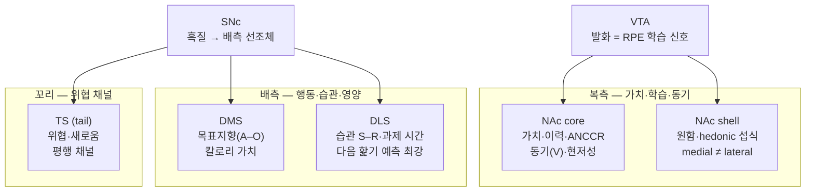

> [!takeaway] 연구 방향 관점의 핵심
> 위키에 모인 근거로 보면 **도파민은 선조체 전체에 같은 신호를 뿌리지 않고, 부위마다 다른 변수를 싣는다.** 앞쪽·복측(NAc)은 가치·학습·동기, 배측(DMS·DLS)은 행동·습관·영양, 꼬리(TS)는 위협을 맡는 별도 채널이다([[concept-striatal-dopamine-gradient]]). 사용자 연구에 바로 걸리는 두 가지: (1) **vigor는 개시(bout 수)와 유지(bout 길이)로 나눠 재야 한다** — 말단 도파민은 개시만 강화한다([[gordon-2026-lateral-hypothalamic-control-of-the|Gordon 2026]]). (2) **ANCCR은 NAc core에서만 검증됐다** — "NAc 도파민" 한 지점의 결과를 선조체 전체로 일반화하지 말 것.

# 선조체 부위별 도파민의 역할

## 한 줄 요약
2026-10-25 사용자 질문("도파민의 역할을 뇌 부위별로 — striatum·NAc·DMS·DLS, vigor·cue value·RPE·ANCCR 등")에 위키 페이지만 근거로 답한 내용을 보관한 종합 페이지. 부위별 도파민 신호(표 1), 역할 × 부위 근거 강도(표 2), 해석 주의 세 가지, 위키 자료 공백으로 구성된다.

> [!note] 근거 범위
> - 근거는 이 위키의 페이지뿐이다(웹 미사용). 각 칸의 주장은 2026-10-25에 해당 페이지 본문과 다시 대조했다. 원문 PDF까지 다시 대조하지는 않았다.
> - "2차"는 위키가 원전 없이 리뷰·해설을 통해서만 가진 근거다.
> - DLS는 배외측 선조체(dorsolateral striatum)다. 위키 일부에서 같은 약어로 쓰는 배외측 중격은 제외했다.

## 그림 — 선조체 아구역별 도파민 역할 지도

- 투사 축: SNc → 배측 선조체(흑질선조체 경로), VTA → NAc(중변연계 경로)([[concept-dopamine-reward-system]]).
- 공간 축: 왼쪽(NAc)이 전방, 오른쪽(TS)이 후방. 소비 중 방출은 **후방(DLS)에서 먼저, 전방(NAc)에서 나중**에 나타난다(Gordon 2026).

## 표 1. 부위별로 도파민이 싣는 것

| 부위 | 도파민이 싣는 것 | 핵심 근거 | 주의할 점 |
|---|---|---|---|
| **VTA (세포체 발화)** | RPE 학습 신호, 소비 중 맛의 좋음(기호성)에 비례한 bout 연장, 영양 학습용 sync state | 발화는 RPE를 싣고, NAc 방출은 학습과 동기를 함께 싣는다([[mohebi-2019-dissociable-dopamine-dynamics-learning-motivation|Mohebi 2019]]). 핥기에 맞춘 폐루프 VTA 도파민 회로 조작이 기호성에 비례해 bout 길이를 늘린다([[zhu-2025-hedonic-eating-is-controlled-by|Zhu 2025]]). 섭취 ~30초 뒤 0.8 Hz 동기 버스트(sync state)가 영양 학습을 맡는다([[yang-2026-a-sync-state-in-the|Yang 2026]]) | 발화와 말단 방출은 따로 움직인다. 동기 ramp는 발화 없이 NAc 방출에서 나타난다(Mohebi 2019) |
| **NAc core** | ANCCR(회고적 인과 학습), state value V, cue의 주관적 가치, 지각된 현저성 | ANCCR: 무예측 sucrose를 반복할수록 반응이 커지고, 직전 보상 간격(IRI)이 길수록 커지며, 소거 뒤에도 cue 반응이 남는다([[jeong-2022-mesolimbic-dopamine-release-conveys-causal|Jeong 2022]], [[concept-anccr]]). V의 절댓값은 동기, 급한 변화는 RPE([[hamid-2016-mesolimbic-dopamine-signals-value-work|Hamid 2016]]). cue 도파민은 객관적 보상 크기가 아니라 주관적 가치를 따른다([[pascoli-2026-conditioned-accumbal-dopamine-transients|Pascoli 2026]]). 앞쪽 core(NAcCR)가 용액 가치·최근 이력을 가장 강하게 싣는다(Gordon 2026). 지각된 현저성은 Kutlu 2021의 해설로만 있다([[chen-2021-neuromodulation-a-model-for-dopamine|Chen 2021]], 2차) | NAc에서 RPE 모양 신호가 가장 뚜렷했지만, 결과 시점에 자극하거나 억제해도 다음 선택은 바뀌지 않았다([[blanco-pozo-2024-dopamine-independent-effect-rewards-choices|Blanco-Pozo 2024]]) |
| **NAc shell** | 원함(wanting)과 hedonic 섭식. medial shell과 lateral shell은 서로 다른 아구역 | CeA 자극이 원함을 만들 때 NAc medial shell Fos가 오른다([[warlow-2021-incentive-motivation-wanting-roles|Warlow 2021]]). DA-글루탐산 공동전달 뉴런(VGLUT2⁺)은 medial shell로 거의 전속 투사한다([[mingote-2019-dopamine-glutamate-neuron-projections-to|Mingote 2019]]). 혐오 자극에는 shell이 늦게(안도·회피 성공 예측 시점), core는 즉시 방출한다([[schultz-2016-dopamine-reward-prediction-error-signalling|Schultz 2016]], [[concept-reward-prediction-error]]) | medial shell(NAcShM) 도파민은 다음 핥기를 예측하지 못했다(OR 0.91, ns). 물 제한·sucrose 조건에서는 NAcCR·NAcShM이 다른 부위와 부호가 반대였다(Gordon 2026). 좋아함(liking) 핫스폿은 도파민이 아니라 오피오이드 중심이다([[concept-hedonic-hotspot]]) |
| **DMS** | 목표지향(행동–결과) 통제, 칼로리(영양) 가치 | 위내 포도당이 있을 때만 오르는 "배측 선조체" 도파민([[tellez-2016-separate-circuitries-encode-hedonic-nutritional|Tellez 2016]]; 저자 표기는 배측 선조체이고, 좌표상 내측-중앙이라 DMS에 해당한다는 것은 [[overview-habitual-overeating-dls]]의 판독). 섭취량이 같을 때 saccharin이 10% sucrose보다 DMS·DLS 도파민이 작다. 다음 핥기 예측 OR 1.27(Gordon 2026) | 습관 전환의 인과 자료는 BLA→DMS·CeA→DMS **입력**에서 나왔고, 도파민 자료가 아니다([[concept-habit]], [[giovanniello-2025-a-dual-pathway-architecture-for|Giovanniello 2025]]) |
| **DLS** | 과제 시간 정보(time-in-trial), 다음 섭취 개시, 가소성 규칙 gating, 습관(S–R) | GLM에서 time-in-trial 성분이 DLS에서 가장 강하고, 다음 핥기 예측 OR 1.32로 7개 아구역 중 최강(Gordon 2026). D2R 또는 presynaptic CB1R을 지우면 DLS eCB-LTP와 단일시행 회피 학습이 실패한다([[piette-2026-striatal-endocannabinoids-drive-one-shot|Piette 2026]]) | "DLS = 습관"은 위키에서 2차 인용(Yin & Knowlton 2006)에 기댄다. 습관 상태의 DLS 도파민을 기록한 자료는 없다([[overview-habitual-overeating-dls]]) |
| **TS (tail)** | 위협·새로움, 행동 예측 오류(action PE) | labeled-line(꼬리 = threat PE), action PE(Greenstreet 2022)([[gershman-2024-explaining-dopamine-prediction-errors-beyond|Gershman 2024]]). 가치·핥기 scaling이 약하고 다른 부위와 상관이 낮으며, 다음 핥기를 예측하지 못한다(OR 1.00). LHA 글루탐산 뉴런 자극이 TS 도파민을 올린다(Gordon 2026) | Menegas 2017·Akiti 2022 등 원전이 위키에 없어 2차 인용이다 |

## 표 2. 역할 × 부위

● 직접 근거 · ◐ 부분·간접·2차 · ○ 약함/음성 · — 위키에 자료 없음

| 역할 | VTA 발화 | NAc core | NAc shell | DMS | DLS | TS |
|---|---|---|---|---|---|---|
| **RPE (학습)** | ● | ◐ (모양은 RPE, 인과 효과 없음) | — | ◐ (NAc>VTA>DMS) | — | ◐ (threat PE) |
| **ANCCR (회고적 인과)** | — | ● (유일한 검증 부위) | — | — | — | — |
| **Cue value (주관적 가치)** | — | ● | ◐ (조건에 따라 부호 반대) | ○ | ○ | ○ |
| **State value·노력 (V)** | — | ● (Hamid·Mohebi·[[salamone-2012-mysterious-motivational-functions-mesolimbic\|Salamone]]) | — | — | — | — |
| **Vigor: 개시 (bout 수)** | — | ● (NAcCR OR 1.13) | ○ (NAcShM 예측 못 함) | ● (OR 1.27) | ● (OR 1.32) | ○ (OR 1.00) |
| **Vigor: 유지 (bout 길이)** | ● (Zhu 2025: 늘림) | — | — | ○ (말단 자극 시 줄어듦) | ○ (말단 자극 시 줄어듦) | — |
| **영양·칼로리** | — | ○ (saccharin 쪽이 더 큼) | — | ● | ◐ | — |
| **습관·가소성** | — | — | — | ◐ (목표지향, 입력 수준) | ◐ (습관은 2차) / ● (D2R gating) | — |
| **위협·현저성** | — | ◐ (지각된 현저성, 2차) | ◐ (혐오 뒤 안도) | — | — | ◐ |

- "RPE (학습)"의 DMS 칸 순서(NAc>VTA>DMS)는 Blanco-Pozo 2024의 신호 강도 표에서 왔다.
- 개시·유지 칸의 OR은 Gordon 2026의 "trial *n* 도파민 → trial *n+1* 핥기" 로지스틱 회귀(물 제한·NaCl 조건)다.

## 읽을 때 걸리는 세 가지

1. **Vigor는 하나의 숫자로 다루면 안 된다.** 도파민 말단 자극은 bout을 시작하는 횟수는 늘리지만, bout 하나의 길이는 늘리지 않았다. DMS·DLS 말단 자극은 bout당 핥기 수를 오히려 줄였다. 단일 부위 자극으로는 총 섭취가 늘지 않았고, 네 부위를 동시에 자극했을 때만 늘었다(Gordon 2026, [[concept-consumption-vigor]]). 반대로 Zhu 2025는 VTA 도파민이 bout 길이를 늘린다고 보고한다. 두 결과는 위키에 충돌로 기록돼 있다([[concept-consumption-vigor]]). 자극 표적(VTA 회로 vs 선조체 말단)과 분석 방식이 다르다.
2. **RPE와 ANCCR이 실제로 갈리는 조건은 좁다.** cue 학습 전후 반응 이동, 보상 누락 시 dip은 두 모델이 같은 예측을 한다. 갈리는 조건은 무예측 보상 반복, 직전 보상 간격과의 상관 부호, 소거 뒤 cue 반응 잔존이다([[concept-reward-prediction-error]], [[concept-anccr]]). ANCCR은 **NAc core에서만** 검증됐다. DMS·DLS·TS 도파민도 ANCCR을 따르는지는 자료가 없다.
3. **배쪽→등쪽으로 통제가 옮겨 간다는 dorsalization은 학습 시간척도의 이야기다.** 초 단위에서는 한 아구역의 도파민 방출이 다른 아구역으로 거의 퍼지지 않았다. 예외는 TS 자극이 DLS를 소폭 올린 것 하나다(Gordon 2026, [[luscher-2021-consolidating-the-circuit-model-for|Lüscher 2021]], [[concept-striatal-dopamine-gradient]]).

## 위키에 자료가 없는 것
- 습관 상태(가치 절하 둔감 상태)의 DLS 도파민 기록.
- NAc core 밖(DMS·DLS·TS)의 ANCCR 검증.
- TS 원전(Menegas 2017, Akiti 2022) — 현재는 Gershman 2024를 거친 2차 인용뿐.

## 사용자 연구 관점의 함의 (연결 가설 — 원 답변에 덧붙인 정리)
- [[concept-need-motivation-pleasure-utility|NMPU]]에 공간 축을 얹으면, 가치·이력(Pleasure/Utility의 교사 신호 성격)은 전방·복측, 행동 출력과 과제 타이밍은 후방·배측이다. 같은 내용을 Gordon 2026 페이지가 "전후축 다점 샘플링이 필요하다"는 설계 요구로 적어 두었다([[proposal-lh-nac-nmpu-neuron-discovery]]).
- 습관적 과식 연구에서 DLS 도파민을 잴 때는 개시(bout 수)와 유지(bout 길이)를 따로 보고, 습관 상태를 가치 절하로 확인한 뒤 기록해야 위 표의 빈칸을 채울 수 있다([[proposal-habitual-overeating-dls-miniscope]]).

## 관련 페이지
- [[concept-striatal-dopamine-gradient]] — 선조체 도파민의 전후축 공간 조직 hub. 이 페이지의 그림과 표가 기대는 좌표계.
- [[concept-dopamine-reward-system]] — 중변연계·흑질선조체 경로와 도파민 이질성 hub.
- [[gordon-2026-lateral-hypothalamic-control-of-the]] — 7개 아구역 동시 기록·다음 핥기 OR·후→전 파동·국소 조립의 1차 근거.
- [[concept-reward-prediction-error]] · [[concept-anccr]] — RPE와 ANCCR의 판별 조건.
- [[jeong-2022-mesolimbic-dopamine-release-conveys-causal]] — NAc core ANCCR 원전.
- [[concept-consumption-vigor]] — vigor의 개시/유지 분해와 Zhu 2025 vs Gordon 2026 충돌.
- [[concept-nucleus-accumbens]] — core/shell 하위 구역과 혐오 자극 반응 차이.
- [[concept-habit]] · [[overview-habitual-overeating-dls]] — DMS 목표지향·DLS 습관 서술의 근거 수준.
- [[mohebi-2019-dissociable-dopamine-dynamics-learning-motivation]] · [[hamid-2016-mesolimbic-dopamine-signals-value-work]] — 발화 vs 방출, value(V) 해석.
- [[blanco-pozo-2024-dopamine-independent-effect-rewards-choices]] — RPE 모양 신호의 인과 효과 부재.
- [[tellez-2016-separate-circuitries-encode-hedonic-nutritional]] — 배측 선조체 = 영양(칼로리) 도파민.
- [[piette-2026-striatal-endocannabinoids-drive-one-shot]] — DLS D2R·CB1R 의존 eCB-LTP.
- [[gershman-2024-explaining-dopamine-prediction-errors-beyond]] — TS threat PE·action PE.
- [[zhu-2025-hedonic-eating-is-controlled-by]] · [[yang-2026-a-sync-state-in-the]] — VTA 쪽 소비 bout 연장과 영양 학습 sync state.
